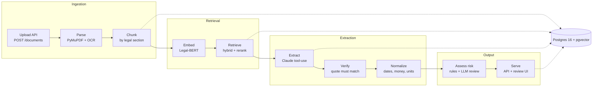

# LeaseSentry

LeaseSentry reads commercial leases and turns them into a one-page summary of the terms that matter. Every answer links back to the exact sentence it came from.

```
 Your lease                   LeaseSentry                  Your summary
 ───────────                  ───────────                  ────────────
 PDF, Word or a scan   ──▶    reads every page      ──▶    Rent increases    [source]
 plus its amendments          finds the key clauses        Renewal option    [source]
                              checks every answer          Notice due soon   [source]  ⚠
                              flags risks and dates
```

---

## For everyone: what is LeaseSentry?

### The problem

Businesses that rent offices, shops and warehouses often manage dozens or hundreds of leases. The facts that cost money are buried in dense legal text and spread across amendments: when the rent goes up, when notice must be given, whether the lease can be renewed, who pays for repairs.

Today someone reads each lease by hand and types those facts into a spreadsheet. This is called **lease abstraction**. It is slow and expensive, and one missed date, such as a renewal notice deadline, can mean losing a location or paying far more rent.

### What LeaseSentry does

1. **You upload a lease.** A PDF or Word file, including a scanned paper copy.
2. **It reads every page** and finds the clauses that matter: parties, dates, rent, rent increases, deposits, renewal and termination rights, and notice periods.
3. **It writes the summary.** Each answer has a "show me" link that opens the lease with the source sentence highlighted.
4. **It warns you** about upcoming deadlines and unusual or risky terms before they become problems.
5. **It covers the whole portfolio.** You can ask questions across all your leases, such as *"which leases end next year with no option to renew?"*

### Who it's for

- Property and facilities managers
- Corporate real estate teams at companies with many locations
- Law firms and paralegals who review leases for clients
- Lenders and investors checking the leases behind a property

### Why you can trust it

Most AI tools give an answer and ask you to believe it. LeaseSentry shows its work: every value must point to real words in the lease, and the system checks that those words actually exist. If it can't find proof, it says **"not found"** instead of guessing. A reviewer can check any answer in one click instead of rereading the lease.

---

## For engineers: how it works

LeaseSentry is a **retrieval-augmented extraction pipeline**. It parses documents with page coordinates, chunks them by legal structure and indexes them in pgvector. An LLM then returns schema-valid JSON in which every value carries a verbatim quote, and each quote is verified against the source.



The upload returns immediately. Every later stage runs in background workers from a Redis queue.

### Pipeline stages

| # | Stage | What happens |
|---|---|---|
| 1 | **Ingest** | `POST /documents` accepts PDF or DOCX, hashes the file to deduplicate it, stores it and queues a job. |
| 2 | **Parse** | PyMuPDF extracts native text with page numbers and bounding boxes. Only scanned pages go to OCR (Tesseract or docTR). |
| 3 | **Chunk** | Splits on legal structure ("ARTICLE V", "Section 4.2") instead of fixed token windows. Tables stay as structured rows. |
| 4 | **Embed + index** | Legal-BERT embeddings (benchmarked against a general embedder), on CUDA when available, stored in pgvector. |
| 5 | **Retrieve** | Hybrid BM25 + vector search, then a reranker, with one query template per clause type. |
| 6 | **Extract** | Claude tool-use returns Pydantic-validated JSON per clause type. A value without a quote and location is rejected. |
| 7 | **Verify** | Each quote is matched back to the source text, exactly first, then fuzzily with `pg_trgm`. Unverified values are flagged, never silently kept. |
| 8 | **Normalize** | Dates, money and durations are converted to canonical units, so "three (3) months" and "90 days" can be compared. |
| 9 | **Assess** | A deterministic rules engine flags risks, and the LLM is used only for judgment calls. Amendments are merged into a "current state" of the lease. |
| 10 | **Serve** | A REST API and a review UI that jumps to the highlighted source span. |

### Tech stack

| Layer | Choice | Why |
|---|---|---|
| API | Python, FastAPI, Pydantic v2 | One set of typed models for the API, LLM tool schema and validation |
| Database | Postgres 16 + pgvector | Relational data and embeddings in one store |
| ORM / migrations | SQLAlchemy 2 (async), Alembic | Mature, async, versioned schema changes |
| Parsing | PyMuPDF, Tesseract / docTR | Fast native text, with OCR only where needed |
| Embeddings | Legal-BERT on CUDA | Tuned for legal language |
| LLM | Anthropic API (Claude, tool use) | Structured output with long context |
| Background jobs | Arq or Celery + Redis | Keeps long-running extraction off the request path |
| Frontend | Next.js + PDF viewer | Click a field to see the highlighted source |
| Tooling | uv, ruff, mypy, pytest, GitHub Actions | Fast installs, strict types, CI on every push |
| Deploy | Docker, Fly.io or Render, then AWS | Simple first, scalable later |

### Core data model

- **Document**: one uploaded file, with its hash, status and owning organisation.
- **Page / Chunk**: text with its page number, character span and bounding box.
- **Extraction**: one pipeline run over a document, recording the model, prompt version and cost.
- **Clause**: a field value plus its citation (quote, page, span, verified flag and confidence).

### Design principles

- **No citation, no value.** Every extracted value must be traceable to the source.
- **Deterministic where possible.** Rules handle dates and thresholds, and the LLM handles interpretation.
- **Measured, not assumed.** A gold-labelled evaluation set runs in CI, so a prompt change can't silently make results worse.
- **Confidential by default.** Lease files never enter git or logs, and tenants are isolated at the row level.
